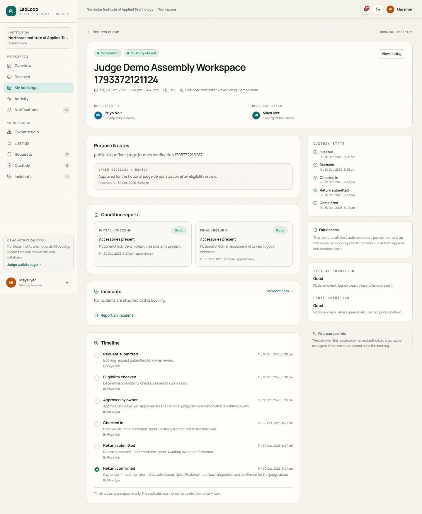

# Public judge demo: verified deployment evidence

**Verified 30 October 2026. Required public acceptance checks passed.**

<https://headline-anticipated-trips-salaries.trycloudflare.com>

This zero-cost judge demo runs the existing Next.js production build with
persistent SQLite on the owner's Windows laptop, through a manually started
Cloudflare Quick Tunnel. No paid hosting, database migration, Windows app service,
automatic startup task or power-policy change was created. Tailscale Funnel is off.
**No guaranteed uptime is claimed.** The laptop, network and current cloudflared
window/process must remain online throughout judging.

## Exact verified configuration

```text
Public HTTPS :443, exact headline-anticipated-trips-salaries.trycloudflare.com
  -> cloudflared 2026.10.6, registered manual Quick Tunnel
  -> filtered ingress 127.0.0.1:3211
  -> existing Next.js production build 127.0.0.1:3210
  -> %LOCALAPPDATA%/LabLoop/judge-demo/fictional-judge.db
```

Existing BUILD_ID: `itApzfwuOZ96pav7ZpWPX`. The development DB is unchanged.
The judge store, backups, session files and unique DPAPI-encrypted session secret
are outside OneDrive/Git, with a current-user/SYSTEM runtime ACL. All three local
listeners, including tunnel metrics on 3212, bind only to loopback.

The exact Host and HTTPS mutation Origin are checked; Next Server Actions did
not need an allowedOrigins exception or wildcard. Cloudflare's edge-overwritten
protocol header controls exact-origin HTTP read upgrades and plaintext POST
rejection. Administrative, developer, private-file, API-debug and metrics paths
are blocked publicly. Public shared credentials cover students and the owner;
manager/admin shared seed credentials are locked and privileged sessions revoked
idempotently in this isolated store. The manager demo-picker button will not
authenticate here; local development manager functionality remains available.

## Executed acceptance results

| Check | Genuine result |
| --- | --- |
| Public owner listing | Owner published a new fictional workspace through the real public form; Priya found it in public search |
| Same-resource full lifecycle | At 2026-10-30 14:57:05 UTC / 20:27:05 IST, discovery, request, owner approval, check-in, initial/final reports, owner return confirmation and completed history passed on that newly published resource |
| Resource evidence | `/resources/23e2c684-50c8-447f-9155-8a9b91b82af7` |
| Completed transaction | `/bookings/8a26a163-dd85-4b9b-bd8c-c55b67230017`, visible after borrower/owner login |
| Public network | Actual HTTPS URL; no browser interception, resolver override or TLS-verification bypass |
| Transport | HTTP login GET -> exact HTTPS 308; plaintext POST, even with spoofed HTTPS header -> 403; HTTPS with spoofed HTTP header -> 200 because Cloudflare overwrites it |
| Restricted paths | Admin, .env, .git, API debug, Next dev/HMR and metrics -> 404 |
| Origin boundary | Foreign-Origin and Origin-less HTTPS POSTs -> 403 |
| Session/headers | Secure, HttpOnly, SameSite=Lax cookie; HSTS, limited CSP, nosniff and frame denial present |
| Privileged login | Published manager seed password rejected over public HTTPS; no session issued |
| App-only restart | User ran `RestartApp`; both app/ingress identities changed while tunnel identity and HTTPS URL remained identical |
| Persistence after restart | Saved owner browser session reopened the completed transaction and both reports over the same public URL; live integrity ok |
| Borrower history | Fresh Priya login reopened the same completed booking, both reports and return-confirmed timeline at 15:39:18 UTC after restart |
| Append-only history | Every pre-restart row in bookings, booking_events, condition_reports and audit_events matched the fresh pre-restart backup; no prior row missing/rewritten |
| Final fresh restore | `judge-20261030T152120690Z.db` restored to a new private file: integrity ok, same workspace/completed booking, 2 reports, 6 timeline events and manager credential lock |
| Preservation | Original development DB, persistent encrypted session-secret file and original production BUILD_ID unchanged |
| Independent device | User confirmed phone/mobile-data access with Wi-Fi disabled: catalog and authenticated Priya dashboard both loaded; confirmation received 2026-10-30 15:21:19 UTC |
| Final live checks | 2026-10-30 15:23:25 UTC / 20:53:25 IST: HTTPS catalog 200, HTTP read upgrade 308 and plaintext POST denial 403 |
| Source checks | 55 Vitest tests across 6 files, typecheck/lint and PowerShell syntax passed |

The phone result is **user-confirmed external accessibility**, not an automated
phone inspection. No phone OS/browser details were collected. The five ordinary
Playwright tests passed earlier; they were not rerun for these operations-only
changes. The real public production browser tests above were executed.

[Sanitized machine-readable evidence](evidence/public-judge-summary.json)
contains the recorded timestamps/checks without cookies, secret values, private
logs or database files. The actual public completed-record screenshot below
contains only verified fictional participants and synthetic condition notes.



## Judge walkthrough

Open `/login`. Use fictional student `priya@labloop.demo` and owner
`owner@labloop.demo`, password `LabLoop!2026`. Do not choose the manager account
on this public demo. All demonstration data is fictional; do not enter personal
or confidential information or reset the judge store.

1. As owner, optionally publish a workspace with rules/hours and no specialist
   qualification if none is appropriate; inspect its public listing.
2. As Priya, choose Open Maker Bench 04 or an eligible open workspace. Review
   standing/rules, request an available slot about 15 minutes ahead and acknowledge rules.
3. As owner, review the request and approve with a written reason.
4. As Priya, check in with initial condition, then return with a final condition report.
5. As owner, confirm hand-back. Both parties can inspect the completed history
   and immutable reports. The concrete transaction above is retained as evidence.

Important access decisions stay role-controlled and reviewable by authorized
owners. Shared student/owner credentials are intentionally public for this
fictional demo; this is not real institutional identity verification.

## Restart, uptime and recovery

**Keep the current cloudflared window/process, laptop and internet online.**
An app-only restart from the repository root is:

```powershell
powershell.exe -NoProfile -File scripts/funnel/judge-demo.ps1 -Action RestartApp
```

It restarts only recorded app/ingress processes, reuses the DB/secret/exact origin,
and rechecks privileged credentials. It does not run/stop cloudflared or change
the hostname. The separate app-launcher window may finish normally; the
cloudflared foreground window must remain running. Stop the app using `-Action Stop`;
that does not stop cloudflared. Stop only the recorded tunnel process after
checking its creation time, or use Ctrl+C in its own foreground window.

After Windows or tunnel restart, a Quick Tunnel gets a **different URL**. With
the app stopped, allocate it manually, review/approve/pin the exact hostname,
configure `-Provider Cloudflare`, start production and repeat public tests.
Update judge links before submission. Server-side DB sessions remain, but
host-bound browser cookies require a new login at a changed hostname.

There is no unattended startup, power change, HA/SLA, load-test or uptime guarantee.
An app-only restart preserving this URL was verified; hostname stability across
tunnel recreation is neither supported nor claimed. No submission form was sent.
The official PDF template, participant IDs and verified contributions remain pending.

## Earlier failures and limits

Tailscale public probes failed and Funnel was disabled. A first Cloudflare
connector exited, producing 530/error 1033. A later hostname passed public tests
but was recreated by the user; those old URLs are obsolete. Earlier HTTP page
serving and shared manager credentials were hardened and retested successfully.

One earlier-host repeat verifier run reached completed custody but did not finish;
its original stage/error was not retained. Visual inspection and later complete
runs passed. Its cause remains unclassified; sanitized failure-stage diagnostics
were added, without claiming a root-cause fix. Current-host required checks above
passed. This is a temporary hackathon demo, not a security or accessibility certification.
See [operations/approval history](CLOUDFLARE_QUICK_TUNNEL.md).
